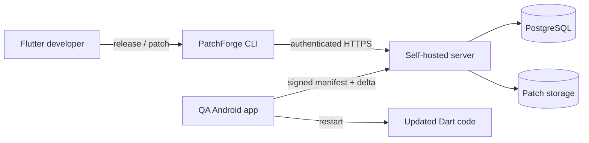
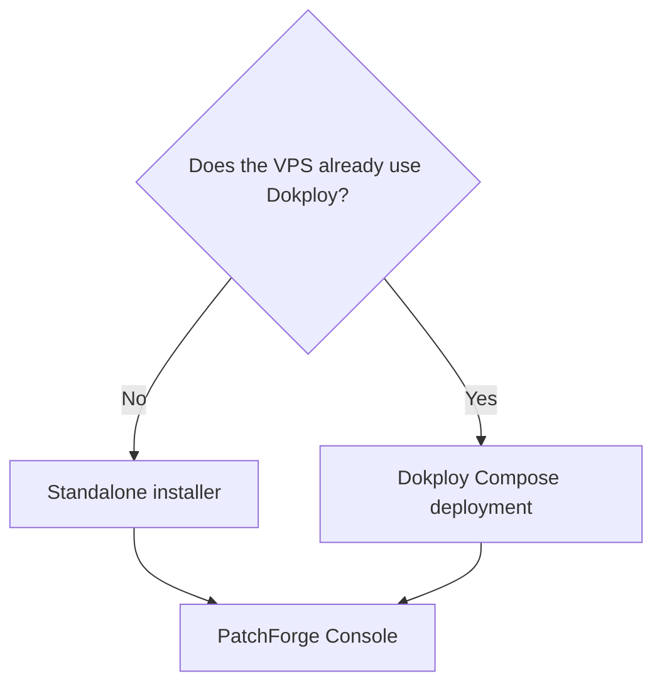
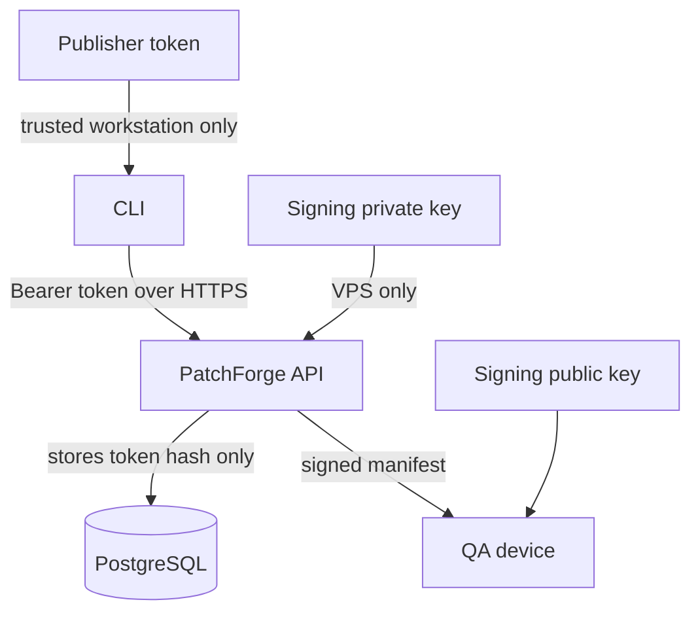

# PatchForge

Self-hosted OTA updates for controlled Flutter Android QA builds.

PatchForge creates signed `bsdiff` patches for Flutter's `libapp.so`, publishes
them from your VPS, verifies them on-device, and activates them after a safe app
restart.

> [!IMPORTANT]
> PatchForge is currently a proof of concept for privately distributed Android
> QA APKs. It is not yet recommended for production Google Play or Apple App
> Store applications. iOS is not supported.



## Choose an installation

Use only one deployment mode on a VPS. Standalone Caddy and Dokploy's Traefik
both require ports 80 and 443, so they cannot run together.

> [!CAUTION]
> The two deployment modes use different VPS management commands. Standalone
> installations use `sudo patchforge ...`; Dokploy installations use
> `sudo patchforge-dokploy ...`. Do not mix these helpers.



| VPS state | Installation | Reverse proxy | Best for |
| --- | --- | --- | --- |
| Clean Ubuntu 22.04/24.04 | [Standalone](#option-a-standalone-vps) | Caddy | Fastest setup |
| Dokploy already installed | [Dokploy](#option-b-existing-dokploy-vps) | Traefik | Dokploy-managed deployments |

Requirements: Ubuntu 22.04/24.04 amd64, a hostname pointing to the VPS, and
inbound ports 80/443. An IP-based hostname such as
`104-207-92-53.sslip.io` is suitable for testing.

### Option A: standalone VPS

Download and inspect the versioned installer:

```bash
curl --fail --show-error --location --retry 5 --retry-all-errors \
  https://raw.githubusercontent.com/Kaung-Myat/patchforge/v0.6.4/scripts/install.sh \
  -o install.sh

less install.sh
```

Install PatchForge:

```bash
sudo env \
  PATCHFORGE_DOMAIN=updates.example.com \
  PATCHFORGE_INSTALL_VERSION=v0.6.4 \
  bash install.sh
```

The installer creates the database, signing identity, publisher credential,
artifact storage, HTTPS proxy, and management command under `/opt/patchforge`.

These commands are for **standalone installations only**:

```bash
sudo patchforge doctor
sudo patchforge status
sudo patchforge publisher-token
```

### Option B: existing Dokploy VPS

Clone the release on the VPS:

```bash
sudo git clone --depth 1 --branch v0.6.4 \
  https://github.com/Kaung-Myat/patchforge.git \
  /srv/patchforge

sudo chown -R "$USER":"$USER" /srv/patchforge
cd /srv/patchforge
```

Generate fresh persistent configuration:

```bash
sudo env \
  PATCHFORGE_DOMAIN=updates.example.com \
  PATCHFORGE_SERVER_IMAGE=ghcr.io/kaung-myat/patchforge-server:0.6.4 \
  bash scripts/prepare-dokploy-install.sh
```

Create a Dokploy Compose service with:

| Setting | Value |
| --- | --- |
| Repository | `https://github.com/Kaung-Myat/patchforge` |
| Branch/tag | `v0.6.4` |
| Compose path | `./deploy/dokploy.compose.yaml` |
| Environment | Contents of `/opt/patchforge/dokploy.env` |
| Domains tab with `sslip.io` | Leave empty |

Deploy, then use the **Dokploy management helper only**:

```bash
sudo patchforge-dokploy doctor
sudo patchforge-dokploy status
sudo patchforge-dokploy publisher-token
```

Do not run `sudo patchforge ...` for this deployment. That command belongs to
the standalone Caddy installation and checks a different configuration file.

See [the complete Dokploy guide](docs/DOKPLOY.md) for migration, upgrades,
resource limits, and recovery.

## Open the console

Visit `https://updates.example.com/console/` and connect with the publisher
token returned by the helper for your deployment mode:

```bash
# Standalone only
sudo patchforge publisher-token

# Dokploy only
sudo patchforge-dokploy publisher-token
```

The token stays in the current browser tab and must never be committed,
embedded in an APK, or given to QA testers.

The console creates applications and releases and displays patch chains. Patch
artifacts are built on a trusted Flutter developer machine.

## Set up a Flutter project

### 1. Install the CLI

The CLI installer can be downloaded and run from any directory on the Flutter
developer machine:

```bash
curl --fail --show-error --location --retry 5 --retry-all-errors \
  https://raw.githubusercontent.com/Kaung-Myat/patchforge/v0.6.4/scripts/install-cli.sh \
  -o install-cli.sh

less install-cli.sh
PATCHFORGE_CLI_VERSION=v0.6.4 bash install-cli.sh
```

Install `bsdiff` and `bspatch` through the workstation's package manager before
publishing patches.

### 2. Create a Flutter project and install the SDK

For a new project:

```bash
flutter create --org com.example patchforge_mobile_fresh_demo
cd patchforge_mobile_fresh_demo
flutter pub add patchforge_sdk
```

For an existing application, run `flutter pub add patchforge_sdk` from that
application's root directory instead.

### 3. Connect and initialize

Create an application in the console and copy its App ID. Then run from the
Flutter project root:

```bash
patchforge login --url https://updates.example.com

patchforge init \
  --url https://updates.example.com \
  --app-id 00000000-0000-0000-0000-000000000000

patchforge doctor
```

`patchforge login` saves the publisher credential outside the project with
mode `0600`. `patchforge init` creates a shareable `patchforge.yaml` containing
only the server URL, App ID, channel, signing-key ID, and public key.

### 4. Start update checks

Configure the SDK once near app startup:

```dart
import 'dart:async';

import 'package:flutter/widgets.dart';
import 'package:patchforge_sdk/patchforge_sdk.dart';

late final PatchForge patchForge;

void main() {
  WidgetsFlutterBinding.ensureInitialized();
  patchForge = PatchForge(
    config: PatchForgeConfig.fromEnvironment(),
  );
  runApp(const MyApp());

  WidgetsBinding.instance.addPostFrameCallback((_) {
    unawaited(_checkForPatch());
  });
}

Future<void> _checkForPatch() async {
  try {
    await patchForge.bootConfirmation;
    await patchForge.update();
  } catch (error) {
    debugPrint('PatchForge update check failed: $error');
  }
}
```

## Release and patch

```mermaid
flowchart LR
    Init[patchforge init] --> Release[patchforge release]
    Release --> APK[Distribute exact QA APK]
    APK --> Change[Make Dart-only change]
    Change --> Patch[patchforge patch]
    Patch --> Open[Open installed app]
    Open --> Stage[Patch staged]
    Stage --> Restart[Restart app]
    Restart --> Confirm[Activated + confirmed]
```



Create the baseline and distribute the printed APK to QA:

```bash
patchforge release
```

After a compatible Dart-only change:

```bash
patchforge patch
```

The existing QA app downloads and stages the signed patch. Close and reopen the
app to activate it; PatchForge automatically confirms a healthy boot.

### Patch or new APK?

| Change | Action |
| --- | --- |
| Compatible Dart logic or Flutter UI | `patchforge patch` |
| Flutter/Dart SDK version | New `patchforge release` APK |
| Native Android code or plugin | New `patchforge release` APK |
| Permissions or Android manifest | New `patchforge release` APK |
| Assets, fonts, or build configuration | New `patchforge release` APK |
| Unsure | Prefer a new APK baseline |

Every device in a patch chain must begin with the exact APK produced by the
matching `patchforge release` command.

## End-to-end QA check

- [ ] `patchforge doctor` passes.
- [ ] `patchforge release` produces the baseline APK.
- [ ] The exact baseline APK is installed on the QA device.
- [ ] The baseline app opens successfully.
- [ ] A Dart-only change is published with `patchforge patch`.
- [ ] The installed app stages the update.
- [ ] Restarting the app activates the changed behavior.
- [ ] The console shows the new patch and confirmed device flow.

## Trust model



| Value | Where it belongs |
| --- | --- |
| Publisher token | VPS administrator, trusted developer machine, CI secret |
| Signing private key | VPS only |
| Database password | VPS only |
| Server URL, App ID, key ID, public key | `patchforge.yaml` and mobile build |

Management operations require publisher authentication. Device update checks
and patch downloads are public but cryptographically verified. The server signs
manifest metadata with Ed25519; the SDK verifies the signature, base hash,
delta hash, reconstructed hash, file size, release, channel, patch number, and
architecture before staging anything.

## Current capabilities

- Android `arm64-v8a`, `armeabi-v7a`, and `x86_64` patch chains
- Signed manifest v2 with stable percentage rollouts
- `development`, `staging`, `beta`, and `stable` channels
- Automatic rollback for an unconfirmed boot
- Signing-key rotation and revocation
- PostgreSQL audit events for authenticated management requests
- Local persistent artifact storage with authenticated HTTPS uploads
- Standalone Caddy and Dokploy/Traefik deployments

## Operations

Choose one column and use only that column for the lifetime of the
installation.

| Task | Standalone (`patchforge`) | Dokploy (`patchforge-dokploy`) |
| --- | --- | --- |
| Health check | `sudo patchforge doctor` | `sudo patchforge-dokploy doctor` |
| Status | `sudo patchforge status` | `sudo patchforge-dokploy status` |
| Server logs | `sudo patchforge logs server` | `sudo patchforge-dokploy logs server` |
| Database backup | `sudo patchforge backup` | `sudo patchforge-dokploy backup` |
| Publisher token | `sudo patchforge publisher-token` | `sudo patchforge-dokploy publisher-token` |
| Upgrade | `sudo patchforge update` | Pin the new tag/image and deploy in Dokploy |

Runtime data is stored under `/opt/patchforge`. Back up the PostgreSQL database,
signing key, publisher token, and patch artifacts before production-like testing
or upgrades.

## More documentation

- [Dokploy installation and migration](docs/DOKPLOY.md)
- [Release checklist](docs/RELEASE.md)
- [Flutter SDK package](sdk/flutter/patchforge_sdk/README.md)
- CLI help: `patchforge --help`
- Release help: `patchforge release --help`
- Patch help: `patchforge patch --help`

## Development

```bash
cargo test --manifest-path server/Cargo.toml --locked
cargo test --manifest-path cli/Cargo.toml --locked

cd sdk/flutter/patchforge_sdk
flutter test
```

PatchForge is licensed under the terms in [LICENSE](LICENSE).
